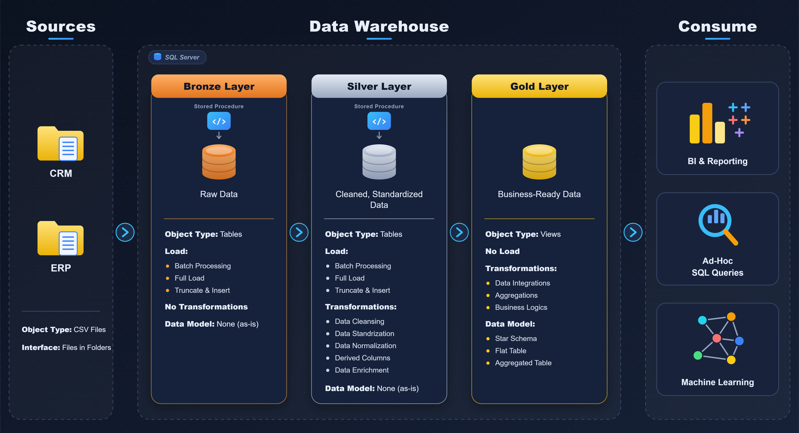

# 🏗️ SQL Server Data Warehouse – Medallion Architecture

An end-to-end data warehouse in **SQL Server**: raw **CRM** and **ERP** CSV files go through **Bronze → Silver → Gold** layers and end up as business-ready views for **BI reporting, ad-hoc SQL and machine learning**.



## 🔄 How it works

| Layer | What happens | Objects | Load |
|---|---|---|---|
| 🥉 **Bronze** | Raw CSV data loaded as-is, no transformations | Tables | Batch, full load (truncate & insert) via stored procedure |
| 🥈 **Silver** | Cleansing, standardization, normalization, derived columns, enrichment | Tables | Batch, full load (truncate & insert) via stored procedure |
| 🥇 **Gold** | Data integration, aggregations, business logic | Views | None – always up to date with Silver |

**Gold data models:** star schema · flat table · aggregated table

## 📤 Consumption

- **BI & Reporting** – Power BI dashboards
- **Ad-hoc SQL queries** – analysis directly on Gold views
- **Machine Learning** – ready-to-use datasets

## 🛠️ Skills demonstrated

`SQL Server` · `T-SQL` · `Stored procedures` · `ETL / ELT pipelines` · `Medallion architecture` · `Data cleansing & modelling` · `Star schema` · `Power BI`

## 📁 Repository structure

```
├── datasets/    # source CSV files (CRM, ERP)
├── docs/        # architecture diagram
├── scripts/     # bronze / silver / gold SQL scripts
├── tests/       # testing silver layer
└── README.md
```
